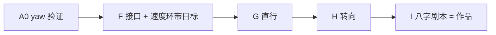

# 11.14 路线：从「能站住」到「能直走 + 转弯」

- 记录：2026-11-14 建立，2026-11-15 按新目标重写
- 对象：Balance（STM32F407 两轮自平衡车，CMake + Ninja + HAL）
- **本阶段目标**：交一个临时作品 —— **无摄像头的固定程序，能直走、能转弯**

### 本文档讲什么

| 本文档 | 负责 |
|---|---|
| `docs/11.14.md`（本文） | **架构与路线**：阶段划分、长期接口（F/G/H）、参数现状、已知坑、暂缓项 |
| `User/Src/Demo/README.md` | **一次性实操**：8 字剧本表、调参顺序、验收标准、完整移除方法 |

**划分原则见 §2.4**：目标量来自传感器反馈 → 长期代码；来自写死的表格 → `Demo/`。

---

## 一、决策：先做 yaw 还是先做别的？

**先做 yaw 验证（5 分钟、零改代码）；其余都是可选。**

只有一件事真正卡着作品：

| | yaw 轴 | 无线遥测 |
|---|---|---|
| 现在状态 | 代码已加，**从未验证** | 代码就位，**未启用**（`MONITOR_OUT_RADIO=0`） |
| 不做会怎样 | 只能用**开环差速**转向（能交作品，8 字略不整齐） | 演示时带根 USB 线 |
| 做了会怎样 | 可用 **yaw 闭环**，8 字角度可控、更对称 | 去掉线缆拖拽 |
| 结论 | **先做**（5 分钟、收益最大） | **交完作品再做** |

> ✅ **阻塞问题已解决**（2026-11-16）：串口改 DMA + JustFloat 52 B，
> `Monitor_Update()` 不再占用主循环。剩下可选的只有「无线的线缆拖拽」。

### 1.1 yaw 为什么值得先做

1. **它是唯一还没验证的未知量** —— pitch 已验证（方向、幅值都正常），
   yaw 是同一颗陀螺的另一个轴，轴映射与符号从未测过
2. **5 分钟成本**，且不需要改任何代码（12 路 `Monitor` 快照里已有 `yaw_rate`）
3. **结果决定作品走哪条路**：符号对 → 可用闭环；不对 → 用开环（照样能交）

### 1.2 yaw 验证**不是**阻塞

这一点必须在设计上保证，否则一条轴没验完就交不了作品：

| 转向方案 | 依赖 yaw | 摔车风险 | 8 字整齐度 |
|---|---|---|---|
| **开环差速**（保底方案） | ❌ 不需要 | **无**（无反馈回路） | 一般 |
| yaw 闭环（升级方案） | ✅ 需要 | 符号错会摔 | 好 |

**所以作品随时可交。** 详见 §I.1。

### 1.3 无线改造为什么可以缓

只剩一件不致命的事：**线缆拖拽** —— USB 线挂车上会改变平衡动力学，
调出来的增益偏保守（不是错）。

✅ **原先那条「阻塞占主循环 46.9%」已经消失**（2026-11-16）：
串口改 `uart_send_floats()` + DMA，`Monitor_Update()` 立刻返回，
`imu_service()` 不再被周期性打断。

---

## 二、现状（2026-11-15 按代码核实）

### 2.1 节拍

| 项 | 频率 | 说明 |
|---|---|---|
| `Attitude_Update` | 1 kHz（TIM7） | `ATTITUDE_DT_S = 0.001` |
| `Control_Update` | 1 kHz（TIM7） | `CONTROL_DT_S = 0.001` |
| `speedL/speedR` | 500 Hz（TIM6） | 2 ms 窗口计数，每个值被控制环用两次 |
| 观测出口 | 100 Hz | USART3 115200 DMA，**52 B/帧**（12 路 JustFloat），占带宽 45% |
| 电机 PWM | 14 kHz | TIM2，ARR = 1000 |

### 2.2 参数（宏在 `Control_PID.h`，小写变量是运行期副本）

| 宏 | 变量 | 当前 | 说明 |
|---|---|---|---|
| PID_PITCH_KP | pid_pitch_kp | **3400** | 用户已从 3000 上调 |
| PID_PITCH_KD | pid_pitch_kd | **200** | 与 KP=3400 搭配（ζ≈0.59） |
| PID_SPEED_KP | pid_speed_kp | 0.001 | 外环比例，偏小 |
| PID_SPEED_KI | pid_speed_ki | 0.0005 | 外环积分，偏小 |
| PID_SPEED_ILIM | pid_speed_ilim | 0.05 | 积分限幅（rad） |
| PID_PITCH_SET_LIMIT | pid_pitch_set_limit | 0.4 | 倾角给定限幅 |
| PID_PITCH_TRIM_RAD | pid_pitch_trim_rad | -0.06 | 机械中值 |
| PID_TURN_KP | pid_turn_kp | **0** | 转向环关闭 → 车会自己慢慢转 |
| CONTROL_DEADZONE | — | **0** | 死区前馈已关闭（补偿失败，见 §九） |

### 2.3 已完成 / 已就位

| 项 | 状态 |
|---|---|
| 参数可写变量（8 个） | ✅ 有真实地址，SWD 可直接改 |
| 电机死区实测 | ✅ 地面 50 / 悬空 40（PWM 计数） |
| 死区前馈 | ⚠️ 已实现但**关闭**（加补偿更抖，见 §九） |
| `Attitude_GetYawRate()` | ✅ 已加，**2026-11-16 A0 已验**：零偏 ±0.001 rad/s，Z 轴映射对，符号已修正 |
| 观测层 12 路（含 yaw_rate / speed_l / speed_r） | ✅ `Monitor` 采集 + `uart_send_floats()` JustFloat，VOFA+ 直读 |
| nRF24 驱动 + 遥测组包 | ✅ 代码就位（`Telemetry.c`），**未启用** |
| `User/{Inc,Src}/Demo/` | ✅ 骨架 + README 已建，**尚不参与编译** |

### 2.4 目录职责：哪些是长期代码，哪些是一次性

这是本阶段最重要的架构约定 —— **一次性的东西不能混进长期代码**。

| 目录 | 归属 | 生命周期 | 说明 |
|---|---|---|---|
| `User/{Inc,Src}/Control/` | **长期** | 一直保留 | 控制调度、PID、LQR、限幅、死区补偿、安全联锁 |
| `User/{Inc,Src}/Attitude.c` | **长期** | 一直保留 | 姿态融合，pitch / pitch_rate / yaw_rate |
| `User/{Inc,Src}/Monitor.c` | **长期** | 一直保留 | 采集 12 路快照 + 限频 + 按出口分发 |
| `User/{Inc,Src}/Telemetry.c` | **长期** | 一直保留 | **无线**遥测组包（seq + float + CRC） |
| `User/{Inc,Src}/Nrf24.c` | **长期** | 一直保留 | 射频驱动，只管寄存器时序 |
| `User/Inc/ImageLink.h` | 占位 | 图传实现后保留 | 大流量单向图传契约，与 nRF24 同插槽互斥 |
| `User/{Inc,Src}/Demo/` | ⚠️ **一次性** | **交完作品即删** | 8 字剧本，见 `Demo/README.md` |
| `Scratch/`（如需要） | 一次性 | 用完即删 | 台架测量、定值 PWM 之类的临时验证 |

**出口分层（2026-11-16 拆分）**：

| 层 | 回答 | 不知道 |
|---|---|---|
| `Monitor` | 系统当前是什么状态 | 数据往哪走 |
| `Telemetry` | 无线链路能塞多少、怎么校验 | 寄存器怎么配 |
| `Nrf24` / `ImageLink` | 字节怎么变成 SPI 波形 | 字节是什么含义 |

出口是**三个独立开关**（可同时开，同一拍数据一起给）：
`MONITOR_OUT_UART`(USART3→VOFA+)、`MONITOR_OUT_RTT`(J-Link)、`MONITOR_OUT_RADIO`(SPI2)。
串口帧格式在 `uart.c`（JustFloat），不在 `Telemetry` 里。

**判断标准一句话**：

> 目标量来自**传感器反馈** → 长期代码；目标量来自**写死的表格** → Demo。

#### Demo 的硬边界

| 规则 | 理由 |
|---|---|
| **只通过 `Control_SetTarget()` 输出** | 绝不直接 `motor_drive()`，否则绕过限幅/死区补偿/安全联锁 |
| **调用点唯一**：`event.c` 的 TIM7 分支，在 `Control_Update()` 之前 | 先下目标，再算输出；顺序反了会用上一拍目标 |
| **开关 `DEMO_ENABLE` 默认 0** | 不参与编译，零 Flash/CPU 成本 |
| **不可被反向依赖** | `Control`/`Attitude`/`Monitor`/`Telemetry` 不知道 Demo 存在 |
| **不注册 HAL 回调** | `HAL_TIM_PeriodElapsedCallback` 等全局弱函数是全工程共享的 |

**为什么 `Control_SetTarget()` 要留在 Control 而不是 Demo**：
它不是 demo 专用 —— 最终循迹层（视觉 → 目标速度 + 目标角速度）也要用同一个入口。
Demo 是它的**临时调用者**，不是它的所有者。

---

## 三、阶段划分

### 3.1 最短可交付路径（交作品只需这 4 步）



| 必须 | 内容 | 谁做 | 归档位置 |
|---|---|---|---|
| **A0** | yaw 轴验证 | 你 | — |
| **F** | `Control_Input` 扩展 + `Control_SetTarget()` | 我 | `Control/`（长期） |
| **G** | 速度环带目标（直行） | 我 | `Control/`（长期） |
| **H** | 差速转向 | 我 | `Control/`（长期） |
| **I** | 八字剧本 | 我 | ⚠️ **`Demo/`（一次性，交完即删）** |

**只有 I 是一次性代码。** F/G/H 是长期能力（最终循迹也要用），所以必须：
- 写在 `Control/` 里，不写进 `Demo/`
- 接口保持通用（`Control_SetTarget(speed, yaw_rate, steer)`），不含任何「剧本」概念

**关键结论：C / D / E 三项都不是作品的必需条件。** ✅ B 已完成（2026-11-16）

| 被砍掉的 | 为什么不是必须 |
|---|---|
| ~~**B CubeMX DMA**~~ | ✅ **已完成**：串口 DMA + JustFloat，CPU 占用 ≈ 0 |
| **C 遥测字段重排** | 有线 12 路已含 `yaw_rate` / `speed_l` / `speed_r`，够用；只有无线才需要重排 |
| **D nRF24 无线** | 纯锦上添花，且 PC 端桥接板还没写 |
| **E 标 k_x** | ⚠️ **`target_speed` 直接用「计数/2ms」当单位试即可**，不换算成 m/s 也能跑。k_x 只影响「目标速度用物理单位表示」 |

### 3.2 质量增强（作品能跑了再做）

| 阶段 | 内容 | 收益 | 前置 |
|---|---|---|---|
| ~~B~~ | ~~CubeMX：USART3 DMA + SPI2 分频~~ | ✅ **已完成**（2026-11-16） | — |
| C | 遥测字段按用途重排 | 让无线包带上 yaw_rate / speed_l / speed_r | — |
| D | nRF24 无线 | 去掉线缆拖拽（跑车调增益时数据最干净） | PC 桥接板 |
| E | 标 k_x | 目标速度可用 m/s 表示，增益有物理意义 | — |
| 增强 | 差速同步 + 航向阻尼细调 | 直行不跑偏、八字更对称 | G、H |

### 3.3 并行建议

```
你：A0（5 分钟，VOFA+ 看 yaw_rate） → 告诉我符号与积分幅值
我：F + G + H（长期能力，写进 Control/）
我：I（一次性剧本，写进 Demo/）
你：E（台架推 1 m） → 以后调增益用得上
你：有 PC 桥接板之后 → 我做 C + D（无线）
```

**注意：作品交付不依赖任何 CubeMX 操作，也不依赖 PC 端新硬件。**

⚠️ **F 必须在 I 之前**：`Demo` 的唯一输出口 `Control_SetTarget()` 由 F 提供。
反过来做会让 demo 逻辑倒灌进 `Control/`，破坏 §2.4 的边界。

---

## 四、A0：yaw 轴验证（现在就能做）

**零改代码、零 CubeMX。** 用当前这版（12 路 USART3 JustFloat）即可。

### 步骤

1. 烧录当前工作区
2. 车放桌上，**电机驱动开关关**（轮子不转，但 `car_run` 默认 = 1，编码器与 IMU 照常工作）
3. 打开 **VOFA+**：端口 `COM10`（ST-Link 虚拟串口）、波特率 `115200`、
   数据格式选 **JustFloat**（不是 FireWater、不要勾大端）
4. 建一个 **波形图控件**，接第 **10** 通道 `yaw_rate`

> 12 通道顺序：`pitch` `pitch_rate` `speed_avg` `turn_rate` `vbat` `pitch_set`
> `pwm_common` `acc_tilt` `wheel_dist` **`yaw_rate`** `speed_l` `speed_r`
>
> ⚠️ 量级差两个数量级（`wheel_dist` 万级 vs `pitch` 0.1），**别塞进同一个 Y 轴**。
> 姿态组（`pitch`/`pitch_set`/`acc_tilt`）、转向组（`yaw_rate`/`turn_rate`）、
> 转速组（`speed_l`/`speed_r`）分开建控件。

### 判据（全过才能用 yaw 闭环转向）

> ⚠️ **不过也能交作品**。开环差速转向（§I.1 方案 A）完全不用 yaw。
> 本验证决定的是「能不能让 8 字更对称」，而不是「能不能做」。

| # | 操作 | 期望 | 不过的处置 |
|---|---|---|---|
| 1 | 完全静止 30 s | `yaw_rate` 在 **±0.02 rad/s** 内 | 零偏没标定好 → 重启再试 |
| 2 | **原地右转 90°**（约 1.5 s） | **为正**，幅值 1~1.5 rad/s | 符号反 → 改 `ATTITUDE_GYRO_YAW_SIGN` |
| 3 | 原地左转 90° | 为负，幅值对称 | 同上 |
| 4 | 用 VOFA+ **导出 CSV** 录下判据 2，累加 `yaw_rate × dt` | ≈ **π/2 = 1.57 rad**，误差 <20% | 幅值不对 → 记下实际比例 |
| 5 | 让车前后**倾斜** | `yaw_rate` 基本不动 | 动了 → 轴映射错 |
| 6 | 让车左右**侧倾** | `yaw_rate` 基本不动 | 动了 → 轴映射错 |

> ⚠️ **VOFA+ 与 `telemetry_live.py` 不能同时开**（同一个 COM10 只能被一个程序占用）。
> `telemetry_live.py` 已**不再可用** —— 它找 `0xAA55` 帧头，JustFloat 没有帧头。

### 判据 4 最重要

符号对但幅值不对（比如积分出 0.8 而非 1.57）说明转弯时倾斜耦合进了 yaw 轴。
那时转向环增益要按**实测比例**重标，不能按理论值。

### ✅ A0 实测结论（2026-11-16）

| 判据 | 结果 |
|---|---|
| 1 静止零偏 | **±0.001 rad/s**（门槛 ±0.02，余量充足）✅ |
| 2/3 转向符号 | **左转正、右转负** → 与「右转为正」相反 → `ATTITUDE_GYRO_YAW_SIGN` 已改为 **`-1.0f`** |
| 4 积分幅值 | **未测**（暂不影响作品） |
| 5/6 串轴 | **未测** |

**结论：yaw 可用于闭环转向**（符号已对齐）。但幅值比例未知 —— 闭环增益第一次跑车时从
**小值起调**（建议 `PID_TURN_KP ≤ 1.0`），一旦发现转不够或转过头再逐次加倍/减半。

> ⚠️ 判据 4/5/6 未测的代价：若转向环一开就抖、或「不转时也在缓慢自转」，
> 回查 `ATTITUDE_GYRO_YAW_AXIS`（试 0/1）与幅值比例，不要先怀疑增益。

### 处置对照

| 现象 | 改哪里 |
|---|---|
| 符号反 | `Attitude.h` 的 `ATTITUDE_GYRO_YAW_SIGN` → `(-1.0f)` |
| 串轴（倾斜时 yaw_rate 动） | `Attitude.h` 的 `ATTITUDE_GYRO_YAW_AXIS`（0/1/2 试） |

**不要改 `ATTITUDE_GYRO_LSB_TO_RADS`** —— 那个常数和 pitch 共用，pitch 是对的。

---

## 五、B：CubeMX 一次改两处 —— ✅ 已完成（2026-11-16）

> 两处均已改完并核实，本节保留作记录与复核依据。

**两处一起改，只开一次 CubeMX。** 都在 `Balance.ioc` 里，改完 GENERATE CODE。

### B1 USART3 加 DMA（去掉阻塞）✅

`Connectivity → USART3 → DMA Settings → Add`

| 项 | 值 |
|---|---|
| DMA Request | **USART3_TX** |
| Stream | **DMA1 Stream3**（Channel 4 自动） |
| Direction | Memory To Peripheral |
| Priority | Low |
| Mode | **Normal**（不是 Circular） |
| Increment | Memory **✓**、Peripheral **✗** |
| Data Width | Byte / Byte |

`Connectivity → USART3 → NVIC Settings` → 勾 **`USART3 global interrupt`**

> ⚠️ **两个都要开。** HAL 的 `UART_DMATransmitCplt()` 在 Normal 模式下搬完只是
> **打开 USART 的 TC 中断**，真正收尾（回 `READY`、回调）在 `USART3_IRQHandler`。
> 只开 DMA 不开 USART 中断 → 状态永远停在 `BUSY_TX` → 之后每一帧都返回 `HAL_BUSY`，
> **遥测静默失效**（不报错，最难查）。

### B2 SPI2 分频 2 → 8 ✅

`Connectivity → SPI2 → Parameter Settings → Clock Parameters → Prescaler`

| | 原来 | 现在 |
|---|---|---|
| 分频 | 2 | **8** ✅ |
| SCK | 21 MHz | **5.25 MHz** ✅ |

nRF24 的 SPI 上限是 10 MHz，21 MHz 会大量掉包或完全不响应。
`.ioc` 等价写法：`SPI2.BaudRatePrescaler=SPI_BAUDRATEPRESCALER_8`

### 生成后自检（已核对通过）

- `Core/Src/usart.c:135`：`HAL_NVIC_EnableIRQ(USART3_IRQn)` ✅
- `Core/Src/usart.c`：`hdma_usart3_tx` = DMA1_Stream3 / CH4 / Normal / Low / Byte-Byte ✅
- `Core/Src/stm32f4xx_it.c:257`：`USART3_IRQHandler` ✅
- `Core/Src/stm32f4xx_it.c:214`：`DMA1_Stream3_IRQHandler` ✅
- `Core/Src/spi.c:82`：`SPI_BAUDRATEPRESCALER_8`（5.25 MBits/s）✅

---

## 六、C ~ E：质量增强（不阻塞作品）

> 三项都不影响「交出作品」。交完作品再来做。

### C 遥测字段重排（无线才需要）

**前提已变（2026-11-16）**：串口侧改为 VOFA+ JustFloat，**12 路全发、无 CRC、无 seq**，
不需要为它重排任何东西。本节现在**只服务无线链路**。

**问题：nRF24 单包只有 32 B = seq(2) + 7×float(28) + crc(2)。**
`Telemetry_Send()` 只取快照的**前 7 路**
（pitch / pitch_rate / speed_avg / turn_rate / vbat / pitch_set / pwm_common），
**恰好缺了直行和转向最需要的 `yaw_rate`、`speed_l`、`speed_r`。**

所以无线要发的那 7 路要**按用途重排**：

| 索引 | 字段 | 用途 | 无线包内 |
|---|---|---|---|
| 0 | pitch | 直立 | ✅ |
| 1 | pitch_rate | 直立 | ✅ |
| 2 | speed_l | 差速同步 | ✅ |
| 3 | speed_r | 差速同步 | ✅ |
| 4 | yaw_rate | 航向 | ✅ |
| 5 | pwm_common | 输出 | ✅ |
| 6 | vbat | 电压 | ✅ |
| 7 | speed_avg | 台架 | ❌ |
| 8 | turn_rate | 台架 | ❌ |
| 9 | pitch_set | 台架 | ❌ |
| 10 | acc_tilt | 诊断 | ❌ |
| 11 | wheel_dist | 标 k_x | ❌ |

⚠️ **重排只能在 `Monitor.c` 的 `monitor_collect()` 里做一次**（两个出口共用同一张表），
不要给无线单独搞一张 —— 那会让 VOFA+ 的通道号和无线包序号对不上。

代价：`wheel_dist`（标 k_x 用）落到第 11 位，**无线看不到** → 标 k_x 走有线（本来就是台架活）。

| 出口 | 每帧 | 100 Hz 占用 CPU | 带宽占用 | 线缆 |
|---|---|---|---|---|
| UART JustFloat（现在） | 52 B | **≈ 0%**（DMA） | 45% | 有 |
| nRF24 1 Mbps（32 B） | 32 B | **2.6%** | — | 无 |

> UART 阻塞那条已消失：`Monitor_Update()` 调的是 `uart_send_floats()`，内部走 DMA。

### D nRF24 无线（可选，看 PC 端硬件）

代码已就位（`Nrf24.c` 驱动、`Telemetry.c` 组包），启用只需 `Monitor.h` 两个宏：

```c
#define MONITOR_OUT_RADIO       1   /* 打开无线出口 */
```

并确认 `Monitor.c` 里 `Telemetry_Init()` / `Telemetry_Send()` 被调用（已写好）。

**硬前提：PC 端需要「第二块 nRF24 + 一块 3.3 V MCU」做 USB 串口桥**
（收到的 32 B 原样从串口吐出）。`tools/nrf24_bridge` 尚未编写（约 20 行）。

- 有这块板 → **强烈建议做**：一步同时解决「线缆拖拽」，跑车数据最干净
- 没有 → 继续用 VOFA+ 有线（DMA 已经把 CPU 占用压到 0）

⚠️ `nrf_send()` 是**非阻塞**的：FIFO 满直接丢帧返回 false，绝不等待控制环。
⚠️ 模块 VCC-GND 必须就近焊 **10 µF + 100 nF**，否则有刷电机换向尖峰会大量掉包。
⚠️ **下行已留接口但未实现**：`Telemetry.h` 的 `TELEMETRY_HAVE_DOWNLINK`（现在 0）。
打开前必须先让 `Nrf24.c` 实现接收 —— 现在 `NRF_CONFIG_TX=0x0E`（`PRIM_RX=0`）是纯发送模式。
⚠️ nRF24 与自制图传**共用 PD9(CS)/PD11(CE) 同一插槽**，物理互斥，见 `User/Inc/ImageLink.h`。

### E 标 k_x（台架，与 C 并行）

有**电机驱动开关**就最简单 —— 不用进 UI、不用切手动：

1. **电机驱动开关关**（电机没力，PID 空转但推得动）
2. 上电。`car_run` 默认 = 1，TIM6 已在累加 `wheel_dist`，**不要按 KEY0**（会停 TIM6）
3. 先验证编码器活着：手推车轮几圈，看 `wheel_dist` 是否变化
4. 记 D0，向前推 20 cm 记 D1 …… 到 100 cm 记 D5
5. `k_x = (D5 − D0) / 1.00`（counts/m，**左轮**）
6. **只能单向推**（来回推正负相减）；分 5 段是为了避开 USB 线拉扯

⚠️ **测完必须断电重启**：`Control_Update()` 的 `!car_run` 分支**不清速度积分**
（只有手动分支和姿态联锁分支才 `reset()`）。推 1 m 后 `s_speed_int` 顶到 `ILIM = 0.05`，
此时直接开电机开关，`pitch_set` 瞬间变成 `-0.06 − 0.05 = -0.11 rad ≈ -6.3°` → 立刻后仰倒下。

---

## 七、F ~ H：控制层长期能力

> ⚠️ **这三节写的是长期代码**，进 `Control/`，最终循迹/竞速还要用。
> 一次性演示部分（八字剧本）已移出，见 §I 与 `User/Src/Demo/README.md`。

### F 接口扩展（我做）

`Control_Input` 增加字段，`Control` 增加目标量接口：

```c
typedef struct
{
    float pitch;            /* rad */
    float pitch_rate;       /* rad/s */
    float speed;            /* 计数/2ms，左右均值 */
    float turn_rate;        /* 计数/2ms，左快为正（轮速差）*/
    float speed_left;       /* 计数/2ms */
    float speed_right;      /* 计数/2ms */
    float yaw_rate;         /* rad/s，陀螺 Z 轴 */
    float target_speed;     /* 计数/2ms，上层给 */
    float target_yaw_rate;  /* rad/s，上层给（闭环转向用）*/
    float target_steer;     /* PWM 计数，上层给（开环转向用，非 0 优先）*/
    float dt;               /* s */
} Control_Input;

void  Control_SetTarget(float speed, float yaw_rate, float steer);
```

**两个转向目标是互斥的，`target_steer` 优先**：

```c
if (in->target_steer != 0.0f)
{
    steer = in->target_steer;                        /* 开环：直接给差速量 */
}
else
{
    /* 闭环：P + I 跟 yaw_rate，见 §H */
}
```

这样 §I 的剧本表里 `steer` 和 `yaw_target` 两列就能同时表达两种方案，
**切换方案只改数据、不改代码**。

⚠️ **命名要分清两个转向量**（这是最容易混的地方）：

| 量 | 来源 | 含义 | 用途 |
|---|---|---|---|
| `turn_rate` | 编码器 `(L−R)/2` | **轮速差**，累积正比于车身转过的**角度** | 差速同步（长期保持直线） |
| `yaw_rate` | 陀螺 Z 轴 | 车身**角速度** | 航向阻尼（瞬时） |

两者单位都「像」转速，但物理意义不同：`turn_rate` 累积起来是角度（不漂），
`yaw_rate` 有零偏但响应快。**混用会导致积分方向和阻尼方向打架。**

### G 直行控制律 —— ✅ 已实现（2026-11-16）

```c
/* ① 速度环 PI：速度偏差 -> 倾角给定 */
float speed_err = in->target_speed - in->speed;   /* 目标 - 实际 */
s_speed_int += speed_err * pid_speed_ki * in->dt;
s_speed_int  = clamp(s_speed_int, pid_speed_ilim);
pitch_set = pid_pitch_trim_rad - (speed_err * pid_speed_kp + s_speed_int);
pitch_set = clamp(pitch_set, pid_pitch_set_limit);

/* ② 直立环 PD（不动） */
thrust = (in->pitch - pitch_set) * pid_pitch_kp + in->pitch_rate * pid_pitch_kd;

/* ③ 转向：两项独立增益 */
float wheel_diff = in->speed_left - in->speed_right;
steer = - pid_sync_kp  * wheel_diff      /* 差速同步：长期保持直线 */
        - pid_yaw_damp * in->yaw_rate;   /* 偏航阻尼：压瞬时摆动 */
```

⚠️⚠️ **`speed_err` 必须是「目标 − 实际」，写反必然发散**（2026-11-16 踩过）。

推导：`thrust = KP·(pitch − pitch_set)`，`pitch_set` 越**负**推力越大。
所以「比目标慢」必须让 `pitch_set` 变得更负：

```
慢（speed < target）→ speed_err = target−speed > 0 → pitch_set = trim − 正数 → 更负 → 推力↑ ✓
写成 speed−target    → speed_err < 0 → pitch_set 往 0 靠 → 推力↓ → 更慢 → 积分越攒越负
                       → 下一拍要求更多前倾 → 冲得更快 → 正反馈，越冲越快直到倒下 ✗
```

> ❗ 改前的原式 `pitch_set = trim − (speed·kp + int)` 在 `target = 0` 时等价于
> 「实际 − 目标」，本身就是正反馈（越跑越快），只是该项小时被 PD 掩盖。
> 这正是旧记录里「重心一变就逐渐跑」的真正原因之一。

**为什么「差速同步」是直行的关键**：`speed_left − speed_right` 累积起来
就是**两轮转过的角度差**，正比于车身转过的角度。用它做比例反馈，
**天然不漂**；而 `yaw_rate` 只能提供瞬时阻尼，单独用必然慢慢跑偏。

新增宏（`Control_PID.h`）：`PID_SYNC_KP`、`PID_YAW_DAMP`，**当前都是 0**
（与改前行为完全一致），逐项加。对应运行期副本 `pid_sync_kp` @ `0x20000910`、
`pid_yaw_damp` @ `0x20000914`，SWD 可在线改。

**调参顺序**（先直行，再阻尼）：

| 步骤 | 动作 | 判据 |
|---|---|---|
| 1 | `PID_SYNC_KP` 从 0 加到 **0.5** 起 | 手推车让它偏一点，松手后是否回正 |
| 2 | 逐次加倍到 **2~4** | 回正变快但不振荡 |
| 3 | `PID_YAW_DAMP` 从 0 加到 **5** 起 | 车头瞬时摆动是否减小 |
| 4 | 逐次加倍到 **20** | 摆动收敛，且转向不迟钝 |

⚠️ **`target_speed` 的单位是「编码器计数 / 2 ms」**，不是 m/s。
**已实测 k_x = 226,080 counts/m**（8 次 1 m 推车，sd 0.9%）：

| target | m/s | cm/s |
|---|---|---|
| 30 | 0.066 | 6.6 |
| 60 | 0.133 | 13.3 |
| 100 | 0.221 | 22.1 |
| 200 | 0.442 | 44.2 |
| 300 | 0.663 | 66.3 |
| 500 | 1.106 | 110.6 |
| 732（满占空比） | 1.619 | 161.9 |

换算：`1 m/s 需要 target = k_x / 500 = 452.2`；`1 count/2ms = 0.00221 m/s`。

### H 转向控制律

```c
steer = pid_turn_kp  * (in->target_yaw_rate - in->yaw_rate)  /* 目标转向 */
        - pid_turn_ki * s_yaw_int                            /* 顶死区 */
        - pid_sync_kp * wheel_diff                           /* 直线偏置 */
        - pid_yaw_damp * in->yaw_rate;
```

**必须带积分**：慢自转时 `steer` 只有 4~8 PWM，全落在 `d0 = 50` 以内
（共模补了、差模没补）。

⚠️ 大转向时一侧轮子的 `|thrust − steer|` 会落进死区 → 绕单轮转而非原地转。
这是 §九 记下的死区遗留；若转向手感差，再单独给差速补一个小前馈。

### I 八字剧本 —— 已隔离到 `Demo/`

⛔ **本节的实操细节不在本文档，见 `User/Src/Demo/README.md`。**

原因：8 字剧本的目标量来自**一张写死的表格**（第几秒多快、往哪拐），
没有反馈、不能应变。**它不属于最终巡线/竞速架构** —— 正式产品的目标量必须来自传感器。

所以代码隔离在 `User/{Inc,Src}/Demo/`，主控制层只暴露一个通用入口
`Control_SetTarget()`，**对 demo 的存在一无所知**。

#### I.1 唯一需要记住的边界

| 规则 | 说明 |
|---|---|
| Demo 只依赖 `Control_SetTarget()` | 绝不直接调 `motor_drive()`（会绕过限幅、死区补偿、安全联锁） |
| 调用点在 `event.c` 的 TIM7 分支 | **必须在 `Control_Update()` 之前**：先下目标，再算输出 |
| 开关 `DEMO_ENABLE`（`Demo.h`） | 默认 0，不参与编译 |
| 目录可整体删除 | 三处：目录、CMakeLists 一段、`event.c` 三行 |

#### I.2 转向双方案（决定是否卡在 yaw 验证上）

| 方案 | 形式 | 依赖 yaw | 摔车风险 | 8 字整齐度 |
|---|---|---|---|---|
| **A 开环差速**（先做） | `steer = ±80`（> 死区 50） | ❌ 不需要 | **无**（无反馈回路） | 一般 |
| B yaw 闭环（再升级） | `steer = Kp·(target − yaw)` | ✅ 需要验证 | 符号错会摔 | 好 |

> **方案 A 完全不需要 yaw**，所以即使 yaw 验证不过，作品照样能交。
> 这让 yaw 从「阻塞」降级为「质量提升」。

#### I.3 内容去向

| 内容 | 位置 |
|---|---|
| 剧本表（6 段、数值依据） | `Demo/README.md` §3.3 |
| 段落结构体与双终止条件 | `Demo/README.md` §3.2 |
| 触发方式（`car_run` 上升沿） | `Demo/README.md` §3.1 |
| 调参顺序（5 步） | `Demo/README.md` §四 |
| 安全中止 | `Demo/README.md` §五 |
| 验收标准（5 条） | `Demo/README.md` §六 |
| **移除方法** | `Demo/README.md` §七 |

---

## 八、已知坑

1. **死区只能补共模**。补到差模会把小 `steer` 放大成 ±50 的甩车；
   也不能放进 `control_limit()`（那是逐轮调用）。
2. **停车分支不清速度积分**（`!car_run`）。台架推车后必须断电重启，否则 `pitch_set` 会突跳。
3. **`Attitude_Update()` 不检查 `imu_seq`**：每 1 ms 无条件下用当前快照。
   `imu_service()` 在主循环 → 主循环被阻塞时数据断流，期间重复用同一快照。
   影响：30 Hz 时 D 项有效超前从 90° 剩 50.6°，**68 Hz 以上翻转为激励** → 压低 KD 上限。
   ✅ **DMA 已落地**（2026-11-16），断流从 4.69 ms 降到 ≈0；但 `imu_seq` 检查本身仍未加。
4. **`speedL/speedR` 是 `int16_t` 但没有 `volatile`**；`0.5f*(speedL+speedR)` 是两次独立读。
5. **`wheel_dist` 只在 `car_run=1`（TIM6 在跑）时累加**，标 k_x 必须处于启动状态。
   ✅ **k_x 已实测（2026-11-16）：226,080 counts/m**（8 次 1 m，sd 0.9%，范围 ±1.5%）。
   ⚠️ 旧文档/记忆里的 `k_x ≈ 6500` 是错的（差 35 倍），不要再引用。
6. **CubeMX 生成文件里的时钟/分频一律由你在 CubeMX 改**，不要改 USER CODE 段覆盖。
   ✅ 已完成：SPI2 分频 8、USART3 DMA + NVIC。
7. **`CONTROL_DT_S` 的注释写「TIM5 1kHz」是过期的**，实际跑在 TIM7。`Attitude.h` 同样。
8. **`uart_printf` 与 DMA 发送共用 `huart3`**：DMA 发帧期间调 `uart_printf`
   HAL 返回 `HAL_BUSY`，那行日志**静默丢失**。当前 `uart_printf` 全工程 0 调用点，暂未暴露。
9. **VOFA+ 与 `uart_printf` 会互相污染**：JustFloat 靠帧尾同步，夹在中间的 ASCII 日志
   会让那一段被丢弃。要波形就别打日志，要日志就别开 VOFA+。
10. **速度环 P 项必须对偏差限幅**（`PID_SPEED_ERR_LIM`）。`speed_err × KP` 直接产出 rad，
   不限幅时目标 500 → −500×0.002 = −1.0 rad，`pitch_set` 撞到 0.4 限幅 → 满反转摔车。
11. **加速度计的线性加速度污染**（见 §9.2）：加速时 `acc_tilt` 被读成 0，
    速度越高摔得越快 —— 这是「200 必摔、60 能跑」的根因，不是参数反了。
12. **速度环偏差符号必须是「目标 − 实际」**。写成「实际 − 目标」会让积分变正反馈：
    越快 → 积分越极限 → 要求更多前倾 → 冲得更快 → 直到倒下。
    症状就是「一直向前冲、越冲越快、无法回正」。

---

## 九、暂缓项（记着，不做）

### 9.1 死区前馈 —— 已实现但关闭

用户的实测结论：**「死区大了一直抖，小了间断地抖，无法起到消抖的作用」**

| 配置 | 现象 |
|---|---|
| 无补偿 + KD 200 | 高频振动 |
| 无补偿 + KD 100~130 | 可较稳定直立 ✅ 当前状态 |
| 补偿 = 50 | 持续抖（更抖） |
| 补偿 = 25 | 间断抖 |
| KD = 50 | 无法平衡 |

机理：`d0 = 50` 是**实测起转阈值**，等值前馈把工作点精确顶在静摩擦双稳态临界点
→ stick-slip 极限环；补偿量不足则留下残盲区 → bang-bang。

**关键结论：`d0` 不是常数**（悬空 40 / 地面 50 / 电压 ±14% / 温度 / 左右轮 / 正反向），
**不存在能同时满足所有工况的固定补偿值** —— 开环常数前馈这个工具本身不适用。

完整分析见 **`docs/死区问题-技术归纳.md`**（459 行，可交外部专家）。

**当前决定：接受小幅振动，不再追求消除。** 只有新功能暴露稳定性问题时再回头。

### 9.2 线加速度补偿 —— ✅ 门控版已实现（2026-11-16）

**问题**：平衡态 `a = g·tanθ` 时加速度计报「完全直立」，`acc_tilt` 恒为 **0**：

```
f_Y = g·sinθ − a·cosθ = g·sinθ − g·tanθ·cosθ = 0
f_Z = g·cosθ + a·sinθ = g / cosθ
```

互补滤波 τ = 50 ms 把 `pitch` 拉向 0 → 控制器误判「不够前倾」→ 反向推力 → 冲一下停一下。
**倾角需求越大摔得越快**，这就是 200 必摔、60 能跑的原因。

**为什么不做精确扣补**（公式本身是对的）：

```
y = acc[1] + a·cosθ        z = acc[2] − a·sinθ        θ 用上一拍 pitch
```

问题在 `a` 的来源。唯一可用的是编码器速度微分，而 `speed` 是**整数计数 / 2 ms**：

| 量 | 数值 |
|---|---|
| 速度量化 σ（两轮均值） | ≈ 0.2 计数/2ms |
| 1 kHz 差分后噪声 | 0.2 / 0.001 = **200** (计数/2ms)/s |
| τ=50 ms 低通后 | ≈ **20** |
| 真实加速信号 | ≈ **100** |
| 补偿量换算（增益 64） | 噪声 ±1280 LSB vs 信号 710 LSB |

**噪声大于信号**。要压到可用需 τ ≥ 200 ms，而互补滤波本身 τ = 50 ms —— 补偿比误差晚 4 倍到达。
所以精确扣补写成 `ATTITUDE_LIN_ACC_ENABLE`（默认 **0**），只当实验品。

**实际采用的方案：自适应门控**

```c
α_eff = 1 − (1−α)·w        w 在 [A_LO, A_HI] 上从 1 线性降到 0
```

| 状态 | a_abs | w | α_eff | 行为 |
|---|---|---|---|---|
| 静止（计数恒 0） | 0 | 1 | **0.98** | 与原版逐位一致 |
| 匀速巡航（抖动 σ≈20） | ≈20 | ≈0.5 | 0.99 | 轻微减弱，仍能纠漂 |
| 加速（a≈70~100） | ≥30 | 0 | **1.0** | 纯陀螺积分，完全不理加计 |

**为什么这个方案在稳定性上是安全的**：

| 性质 | 说明 |
|---|---|
| 单调有界 | α_eff ∈ [0.98, 1]，只会**更**信任陀螺，不会更信任加计 |
| 符号无关 | 没有「补偿方向」，a 估错最多是门控阈值偏差 |
| 最坏退化 | a 估计彻底失效 → α_eff=0.98 → **等价于改之前** |
| 静止零噪声 | 静止时编码器计数恒 0 → a=0 精确 → 无任何副作用 |

对比精确扣补：增益符号错会让误差**加倍**，直接摔。

**相关宏**（`Attitude.h`）：

| 宏 | 值 | 含义 |
|---|---|---|
| `ATTITUDE_ACC_GATE_ENABLE` | 1 | 门控开关，0 = 完全恢复原行为 |
| `ATTITUDE_ACC_GATE_A_LO` | 10 | 低于此值完全信任加计 |
| `ATTITUDE_ACC_GATE_A_HI` | 30 | 高于此值纯陀螺积分 |
| `ATTITUDE_LIN_ACC_ALPHA` | 0.02 | a 估计低通，τ = 50 ms |
| `ATTITUDE_LIN_ACC_ENABLE` | **0** | 精确扣补，默认关闭 |

**代价**：Flash +308 B（-O0）、RAM +8 B、CPU ≈ 0.05%（1 kHz 下十几次乘加），
**不新增 libm 调用**（`sinf`/`cosf` 只在 `ENABLE=1` 时才用）。

**调参建议**：默认值针对「200 必摔」的现象。若仍摔 → 把 `A_HI` 降到 **20**（更早切断加计）；
若匀速时 pitch 漂得厉害 → 把 `A_LO` 提到 **15**（巡航时更信任加计）。

### 9.3 速度环增益整定

当前 `KI = 0.0005` → `KI_phys = 0.0065`、`wn_o = 0.25 rad/s`（慢约 4 倍），
这是「重心一变就逐渐跑」的原因。要 `wn_o ≈ 1 rad/s` 需 `KI ≈ 0.005~0.008`。

**但这条要等 F/G 做完**：速度环从「目标恒 0」变成「目标可给」之后，
整定才有意义（否则只会把「不跑」调成「跑得慢一点」）。届时用实测 `k_x` 重算。

### 9.4 摄像头与循迹

`TFT_DirectBlit()` 原语已可用，但缺 SCCB 驱动、OV7725 寄存器表，
且 `dcmi.c` 的 `ExtendedDataMode = 10B` 与 OV7725 的 8 位不符（需 CubeMX 改）。
**本阶段完全不做。**

---

## 十、速查

### 关键换算

| 量 | 值 |
|---|---|
| 陀螺 ±500 dps | 3.054326e-4 rad/s per LSB |
| 加速度 ±4 g | 0.122 mg/LSB |
| 编码器 1 计数/2 ms | ≈ 0.077 m/s（k_x = 6500 时） |
| 1 计数差 ≈ 偏航角速度 | ≈ 1 rad/s（k_x = 6500、轮距 L = 0.15 m） |

### 死区换算（按当前 KP=3400、KD=200）

```
误差盲区 = d0/KP = 50/3400 = 0.0147 rad = 0.84°
D 项跨死区所需角速度 = d0/KD = 50/200 = 0.25 rad/s = 14.3°/s
内环：wn = 8.49 rad/s、T = 0.74 s、zeta = 0.59
```

### 目标速度换算（k_x = 6500 时）

```
speed=5 计数/2ms ≈ 0.38 m/s   （弧段用）
speed=8 计数/2ms ≈ 0.62 m/s   （直线用）
```

### 常用命令

```
构建： cube-cmake --build build/Debug
烧录： VS Code 任务「ST-Link：烧录（构建+运行）」，成功标志 ===== FLASH OK =====
观测： VOFA+ → COM10 / 115200 / 数据格式 JustFloat
      12 通道顺序见 §四，只发不收，波形直接右键导出 CSV
日志： uart_printf()（占 USART3，与 VOFA+ 互斥，详见 §八 坑 9）
```

### 相关文档

| 文档 | 内容 |
|---|---|
| `docs/HANDOFF-balance-2026-11-15.md` | 上一轮交接（遥测层拆分前的状态，其中「USART3 NVIC / SPI2 分频」两个待修项已完成） |
| `User/Src/Demo/README.md` | 8 字 demo 的实操细节（剧本表、调参、验收、移除） |
| `docs/死区问题-技术归纳.md` | 死区/抖动完整分析（交专家用） |
| `docs/姿态估计-线性加速度补偿.md` | 线加速度补偿原理（暂缓） |
| `docs/HANDOFF-balance-2026-11-14.md` | 上一轮交接（遥测层与 nRF24 引入） |
| `CODING_STANDARDS.md` | 审查标准 |
